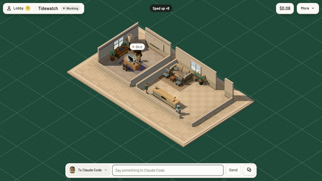
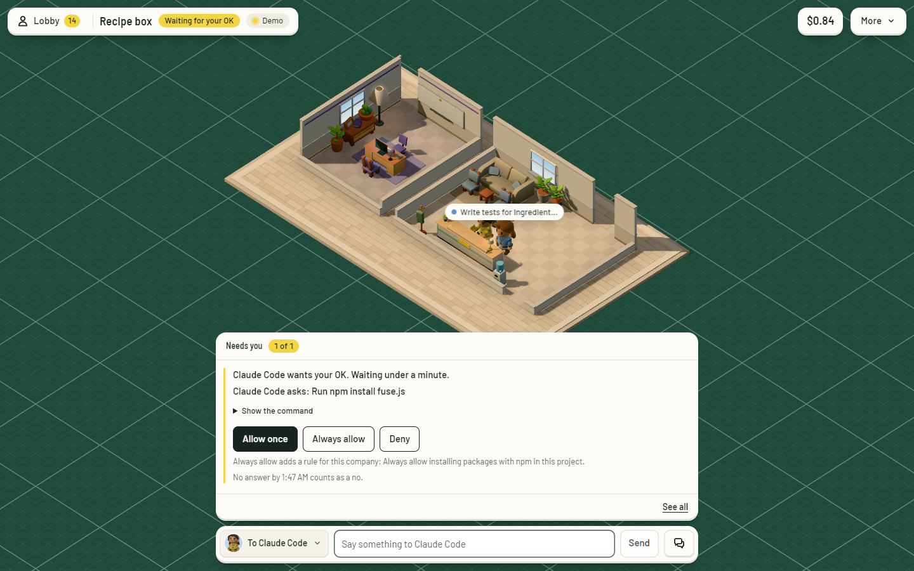
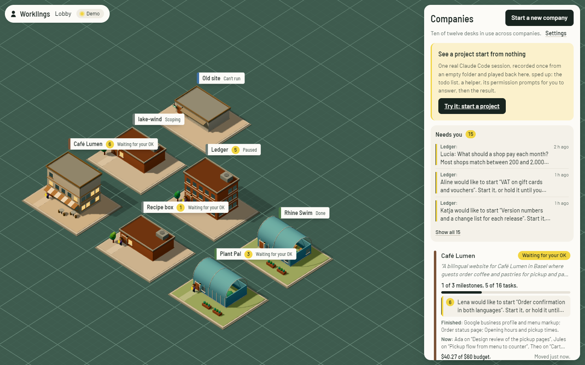
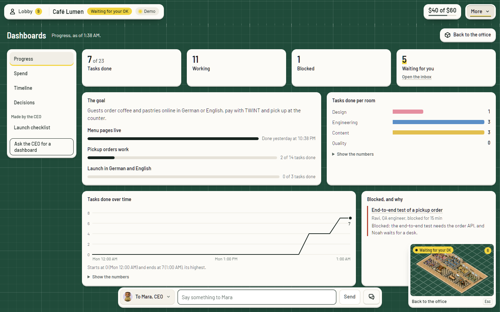
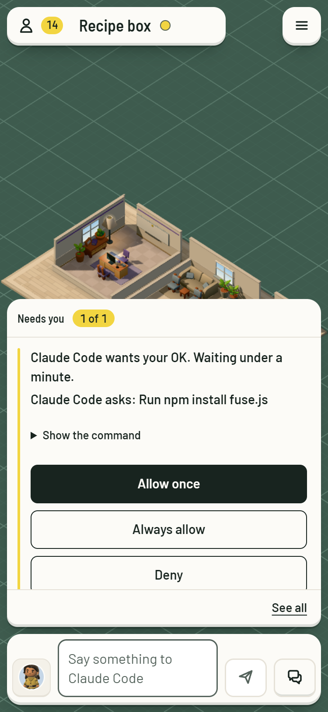
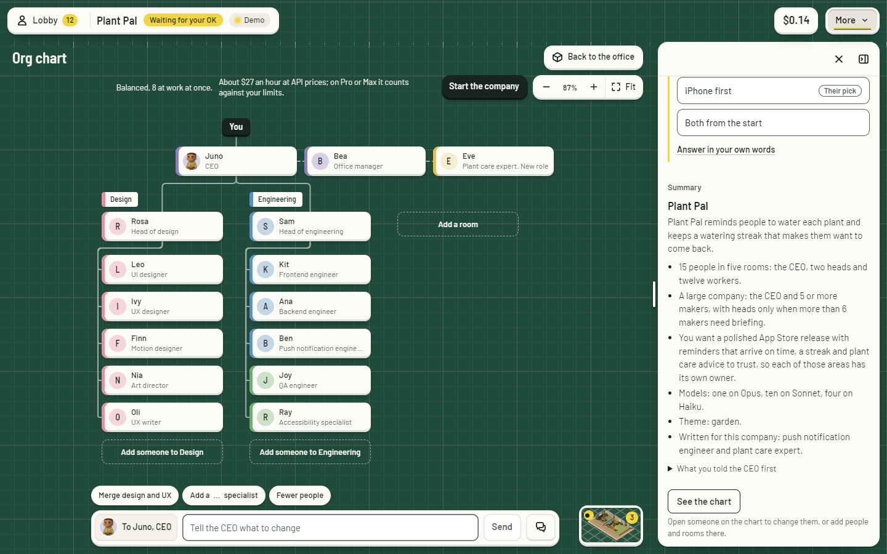
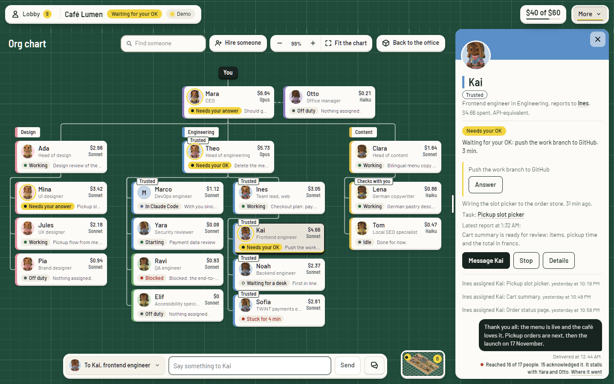
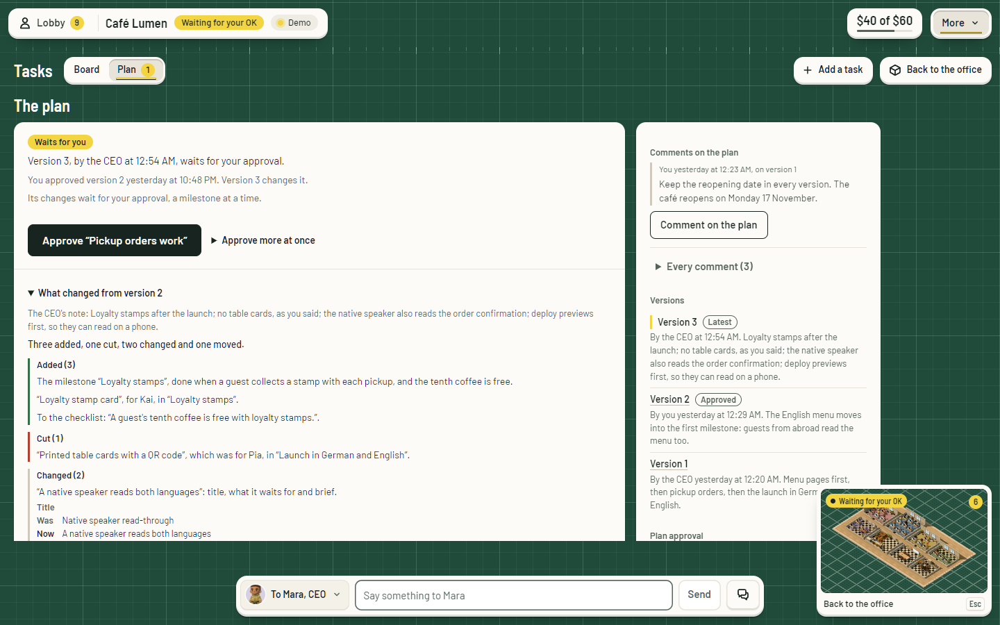

<h1 align="center">
  <picture>
    <source media="(prefers-color-scheme: dark)" srcset="docs/launch/brand/logo-dark.png">
    
  </picture>
</h1>

<p align="center"><strong>Claude Code, with an office around it.</strong></p>

<p align="center">
  <a href="docs/launch/film/hero.mp4"></a>
</p>

*Watch [the launch film](docs/launch/film/hero.mp4) (39 seconds): three real Claude Code jobs started from one sentence
each, a small CLI followed from its office to its last words, and its `npm test` prompt answered on a phone. Shots
that run faster than real time say so; [how it was made](docs/launch/film/how-it-was-made.md).*

<p align="center">
  <a href="https://www.npmjs.com/package/worklings"></a>
  <a href="LICENSE"></a>
  <a href="https://github.com/zeusstudiodev/worklings/stargazers"></a>
  <a href="https://github.com/zeusstudiodev/worklings/actions/workflows/package.yml"></a>
  
</p>

Worklings starts your own, unchanged Claude Code on your words and puts a cozy low-poly 3D office around it: one inbox
for its prompts and questions, budgets, its todo list as a task board and its subagents as helpers with their own cost.

<table>
<tr>
<th width="50%" align="left">Just want to build something?</th>
<th width="50%" align="left">Live in Claude Code already?</th>
</tr>
<tr>
<td valign="top">

1. Try the [live demo](https://zeusstudiodev.github.io/worklings/): nothing to install.
2. Add the [plugin](#try-it-in-30-seconds) to Claude Code and run `/worklings:hub`.
3. Pick a folder and say what you want.
4. Watch it work. Questions and permission prompts wait in the inbox, on your computer or
   [your phone](#phone-access-with-tailscale).

Worklings itself never pushes or deploys. It asks exactly when your Claude Code would.

</td>
<td valign="top">

- **Your `claude`, unchanged:** your CLAUDE.md, skills, hooks, MCP servers and rules.
- **Held to plain `claude -p`** by a [contract test](test/parity-contract.test.ts); the
  [parity bench](#is-it-as-good-as-plain-claude-code) found no difference 20 pairs can detect.
- **Budgets** as Claude Code's own `--max-budget-usd`, and each subagent's cost apart.
- **One inbox** for its permission prompts, questions and plan approvals.
- **From a terminal:** `worklings new ./app --prompt "..."` with `--model` and `--effort` ([more](#run-a-job)).

</td>
</tr>
</table>

## Try it in 30 seconds

You need Node 22 or later. Anything beyond the demo also needs [Claude Code](https://code.claude.com/docs), signed in.

1. **The live demo, with nothing to install:** <https://zeusstudiodev.github.io/worklings/>. It is a made-up café
   company that runs entirely in your browser, with no Claude Code and no server. It is a company of roles, with a CEO
   and an org, so it shows the office and its boards rather than a single Claude Code job.
2. **As a Claude Code plugin:**

   ```bash
   claude plugin marketplace add zeusstudiodev/worklings
   ```

   ```bash
   claude plugin install worklings@worklings
   ```

   Then, in Claude Code, `/worklings:hub` opens the lobby.

3. **From a terminal, with a clone:**

   ```bash
   git clone https://github.com/zeusstudiodev/worklings.git
   cd worklings
   npm install
   npm run build
   node dist/bin.js
   ```

   This opens the lobby of your companies in your browser, with "Open the demo company" (made up, free) and "Start your
   first company". `node dist/bin.js doctor` checks Node, Claude Code and its sign-in, git, the ports and Tailscale, and
   gives one plain fix for anything missing. `npm link` once makes it `worklings` anywhere.

   When the npm package is out, `npx worklings` does the same with nothing to clone. From a clone, read the
   `npx worklings` in the commands below as `node dist/bin.js`, or `worklings` after `npm link`.

The start form asks for a folder, what to build and how the work runs. **One Claude Code session** (the default) starts
at once and takes you straight to the office. **A team (experimental)** takes you to a proposal first. The first time,
the lobby tells you when Claude Code is missing or signed out and what to do (run `claude` once).

## What the office adds

One company per project. By default it is one unmodified Claude Code session working on your words, and the office
reads what it does from its stream without changing it.

### Control

- **Pause, resume and stop** a job.
- **Budgets** per job and per portfolio, at API prices. A job's budget becomes Claude Code's own `--max-budget-usd` for
  what is left of it, so Claude Code stops there. At 80% the inbox tells you.
- **One inbox** for Claude Code's own permission prompts and for its end-of-turn words: when the session ends a turn,
  what it last said (a question, or what it finished) waits there for your reply, which goes back verbatim. The inbox
  has a count on every screen, and the feed over the talk bar answers the same items inline.
- **Steering by message:** what you type in the talk bar reaches the session as you typed it.
- **Model, effort and permission mode per job** at the start (`worklings new --model`, `--effort`,
  `--permission-mode`); anything you leave out is your Claude Code's own default. Effort can also be changed in the
  office, and applies when the desk next opens.



### Organization

- **One company per project,** and one hub on your computer that runs several at once from a lobby.
- **Portfolios** group companies under a name, a shared brief and a shared budget.
- **The studio chat** in the lobby asks and relays across your companies. It cannot write to a plain job: a plain
  session hears only your words.
- **Timeline and history** of each job.



### Granularity

Claude Code's own structure, shown in the office:

| Claude Code | In the office |
|---|---|
| The session | The person at the desk |
| Its todo list | The task board, live |
| Subagents | Helpers beside the desk, each with its own cost |
| Tool calls | Desk activity, and the timeline |
| Plan mode | The plan, approved in the inbox |
| Permission prompts and end-of-turn words | The inbox |

The task board shows a todo list only when the model keeps one: Sonnet 5.5 and Haiku 5.5 keep none by default. Plan
first (`--plan-first`) is an extra, off by default: the job starts in Claude Code's own plan mode, and you approve the
plan in the inbox before it builds.

Progress, Spend and Timeline dashboards are built in. The preview runs the project's dev server behind a proxy on its
own port and shows it in a board over the office, full screen or on your phone.



Clips: [dashboards](docs/launch/clips/dashboards.mp4) and [the preview](docs/launch/clips/preview.mp4).

### Fun

The 3D office fills the window, with boards that open over it and shrink it to a live mini-map. On a phone the office
opens first and what needs you sits on one card over the talk bar; `worklings hub --tailnet` puts it on your phone over
[Tailscale](https://tailscale.com/) (see [Phone access](#phone-access-with-tailscale)).



### What differs from plain Claude Code

One thing a job is refused that Claude Code would allow: **stopping programs machine-wide**, by name, image, pattern or
port lookup. A stop by process id goes through as Claude Code decides. The office's records live in `.worklings/` in
the project, which git ignores; that folder is the one thing a session can see that plain Claude Code wouldn't create.

## Is it as good as plain Claude Code?

We ran a parity bench: 20 pairs over 10 tasks. Existing code: a bug fix, a feature, a refactor guarded by tests and a
change across several files. New projects: two web apps, a CLI, an API, a game and a data script. Both arms used a
blank Claude Code profile, Sonnet, Claude Code's default effort and the same permission mode.

- **Hidden tests:** level. The Worklings arm's pass rate was 4.7 points higher, all of it from one plain run whose game
  could not be served; the interval includes zero.
- **Cost:** 1.01x plain.
- **Extra prompts:** none (0 and 0).
- **A blind pairwise judge** (Opus, both orders) gave the Worklings arm 0.46 on average, where 0.5 is a tie.
- **Time:** median 1.04x per pair. The mean was 1.21x because two Worklings runs hung for five minutes on a test script
  the model itself wrote.

This shows no difference that 20 pairs can detect. It doesn't prove the two are equal, and we don't claim Worklings is
better. The launch is also held to plain `claude -p` by a test
([test/parity-contract.test.ts](test/parity-contract.test.ts)); the differences it allows are listed in
[src/core/plain.ts](src/core/plain.ts).

## The team (experimental)

Choose "A team (experimental)" in the start form, or `worklings new --team`: a Lead plans, a Builder builds, and a
strict Reviewer checks and sends fixes back. In our tests it cost about twice as much as one session and was not
better. It is there for people who want to try it.

A team starts with a proposal of its org, which you can change before you press **Start the company**. The office asks
"How thorough?" (unanswered, Balanced stands), and the proposal shows what each choice costs an hour and for the job:

| | People | At work at once |
|---|---|---|
| Lean | 2 to 4 | 3 |
| Balanced (default) | 3 to 10 | 5 |
| Thorough | 6 to 25 | 8 |

After Start the plan waits for your approval before work begins. A team keeps the steering of earlier versions: a task
board you can reorder, pause and reassign, a decision log with Undo, a leash per person, messages to anyone with `@`,
the command palette (Ctrl+K), and Open in Claude Code, which hands you a person's session. Finished tasks are committed
to the company's own work branch, and nobody pushes. The team's desks start lean: each loads only the tools, skills and
MCP servers its role was assigned, and the office copies your deny and ask rules, hooks, sandbox and environment into
its settings. Approvals follow the office's own policy: routine work goes on, while pushing, deploying, publishing,
spending money, deleting outside the project, messaging people outside the company and changes to `.claude/`,
`CLAUDE.md` or git config ask you.







Clips: [starting a company](docs/launch/clips/start-company.mp4), [the proposal chart](docs/launch/clips/proposal-chart.mp4),
[people at work](docs/launch/clips/people-at-work.mp4), [the inbox](docs/launch/clips/inbox.mp4),
[steering](docs/launch/clips/steering.mp4) and [talking and relays](docs/launch/clips/talking-and-relays.mp4).

`WORKLINGS_SHAPE` (`plain`, `solo`, `harness`, `classic`) is a developer override for the parked shapes of earlier
versions.

## How it compares

Each of these is a good project, for a different job. Facts come from each project's own repository, read on
11 November 2026; star counts and versions move.

| | Worklings | Bot Crossing | Pixel Agents | Claude Squad | Claude Code Game Studios |
|---|---|---|---|---|---|
| What it is | An office around Claude Code: control, organization and a 3D view of each job; also generates a studio for a project | A 3D colony that draws every coding-agent thread on your machine as a bot | An office of pixel-art characters, one per agent terminal | A terminal app that manages several agents, each in its own workspace | A template that turns one Claude Code session into a simulated game studio |
| Runs agents, or only watches | Runs them (your own `claude`, one session per job by default), and watches ordinary sessions | Only watches; it can open a thread in the agent's own app | Launches Claude Code in terminals it hosts, and picks up sessions started elsewhere | Runs them, in tmux sessions on git worktrees | Structures one session's subagents |
| Agents it works with | Claude Code | Claude Code, Codex, OpenCode, Antigravity CLI, Cursor, Hermes, Kilo Code | Claude Code (Codex, Gemini, Cursor and others on its roadmap) | Claude Code, Codex, Gemini, Aider and others | Claude Code |
| What you see | A 3D cut-away office, an inbox, dashboards | A 3D planet, a bot per session | A 2D pixel office with a layout editor | A text interface | A status line |
| Shows cost per agent | Yes, as API-equivalent estimates | Not stated | Not stated | Not stated | Not stated |
| Install | `npx worklings` or the plugin | Clone, `npm install && npm run dev` | VS Code extension, or `npx pixel-agents` | `brew install claude-squad` or an install script; needs tmux | Clone the repository |
| Licence | MIT | MIT | MIT | AGPL-3.0 | MIT |
| GitHub stars | New | 888 | 10,158 | 8,782 | 38,334 |

Where Worklings is behind:

- **It is new,** and it has only been run on Windows. The package check runs on macOS and Linux in CI, but nobody has run
  the full suite or a real job there yet.
- **It works with Claude Code only.** Bot Crossing and Claude Squad already work with other tools; Pixel Agents plans to.
- **It needs more setup than Claude Squad or Pixel Agents** for what they do: Worklings runs a hub, and a job needs a
  signed-in Claude Code.

If you want parallel agents in a terminal with the least ceremony, [Claude Squad](https://github.com/smtg-ai/claude-squad)
fits better. Game Studios' README says its heavier process tier "costs more to reach working code without producing a
better result"; our own benches agree, which is why a Worklings job is one session by default.

Sources, all read on 11 November 2026:
[Bot Crossing](https://github.com/Station-Sciences/bot-crossing),
[Pixel Agents](https://github.com/pixel-agents-hq/pixel-agents),
[Claude Squad](https://github.com/smtg-ai/claude-squad),
[Claude Code Game Studios](https://github.com/Donchitos/Claude-Code-Game-Studios).

## FAQ

### Costs and plan limits

**What does a job cost?** What the same Claude Code session would cost: in the parity bench, 1.01x plain. Spend shows
what the session and each helper used. A team costs more (about twice one session in our tests), and its proposal shows
an hour's cost on your plan before you start. [Measuring a run](#measuring-a-run) says where a run's tokens went.

**Will it use up my Pro or Max plan?** A job is one Claude Code session on your plan, plus the subagents it starts
itself. Several jobs at once, or a team (3, 5 or 8 people at work at once on Lean, Balanced or Thorough), use your
limits faster. Anthropic says plan limits assume ordinary,
individual use. Set a budget to hold a job back before your plan's own limit. When Claude Code reports a limit or
overload, the hub rests every company until the reset time it gives ("Resting until 14:00"), without retry loops, and
work resumes by itself.

**Are the dollar figures a bill?** Not on a subscription. They are what the same tokens would cost on the Claude API at
list prices, with the price date next to the figure. If your own Claude Code uses an API key, or its OpenTelemetry
export points at the office ([how](docs/architecture.md#exact-cost-with-opentelemetry)), they are what was billed.

**Does Worklings cost money?** No. It is MIT licensed, has no account or paid tier, and holds no API key.

### Terms

**Is this allowed by Anthropic's terms?** Worklings is built to stay on the end-user side of them. See
[Terms and publishing](#terms-and-publishing). It is a summary, not legal advice.

### Privacy

**What leaves my computer?** Nothing of Worklings' own: it has no analytics, account or update check, and the hub and
the office listen on `127.0.0.1` and refuse requests from other sites. The one outward path is your own Claude Code,
which talks to Anthropic as it always does. Catch me up and Ask aside run your Claude Code once per press (Haiku by
default) with no tools, no MCP servers and no hooks, so a trimmed excerpt of the session with credentials masked goes to
Anthropic like any Claude Code request. The demo calls nothing.

**What does it write?** `.worklings/` in a company's folder (git ignores it: the signed event log, the state and shared
screenshots); `~/.worklings/` (the hub's registry, the access token, the key that signs each log, portfolios and the
studio chat); and, only for a studio or a team and only when you confirm, files in the project's `.claude/` and
`CLAUDE.md`. A plain job writes nothing in the project besides `.worklings/`. Hooks for watching ordinary sessions, if
you install them, live in `.claude/settings.local.json`, which stays out of git; `worklings hooks uninstall` removes them.

**Does it push my code?** A plain job asks exactly when your Claude Code would, so a push follows your own permission
rules, and its prompt comes to the inbox. A team commits finished tasks to its own work branch, and pushing always asks.

**Are the sessions sandboxed?** No. See [How much to trust a job](#how-much-to-trust-a-job).

### Windows, macOS and Linux

Worklings was built and tested on Windows 11 with Claude Code 2.1.312 and Node 24. Node 22 or later is required. The code
has macOS and Linux paths (opening the browser, finding `claude`, stopping process groups), and CI packs the package and
runs `npx` on Windows, macOS and Linux. **Nobody has run the full test suite or a real job on macOS or Linux yet**:
please report problems as bugs. If Worklings can't find `claude`, set `WORKLINGS_CLAUDE` to its full path.

### Codex later

Not today: Worklings runs Claude Code only. The code that starts, feeds, interrupts and closes a session sits behind a
small interface (`src/runtime/harness.ts`) with Claude Code as its one implementation, so another tool could be added
without rewriting the company. It has no date; see [ROADMAP.md](ROADMAP.md).

## Run a job

From the lobby, pick or create a folder and say what to build. Or from a terminal (the folder can be new or empty):

```bash
npx worklings new ./plant-pal --prompt "A plant-care app with watering streaks"
```

Add `--model`, `--effort` or `--permission-mode` (`acceptEdits`, `auto`, `bypassPermissions`, `manual`, `dontAsk`) for
this job, `--plan-first` to start in plan mode, or `--team` for the experimental team. If a hub is running, the job
starts there; if not, one starts for it. The hub listens on `127.0.0.1:7430` unless you pass `--port`, and prints a link
with an access token (kept in `~/.worklings/token`). A folder that already has a company reopens it. Stop the hub, which
closes every desk first, with `npx worklings hub --stop`; when it opens again, desks pick up where they stopped.

### Phone access with Tailscale

```bash
npx worklings hub --tailnet
```

This serves the hub through `tailscale serve` on your computer's `ts.net` name, over HTTPS, to your tailnet only. It
never uses Tailscale Funnel, so nothing is on the public internet, and every request needs the token in the link it
prints. Treat that link as a password. Set up once, by you:

- Install Tailscale (1.52 or later) on the computer and on the phone, and sign in to the same tailnet on both.
- In the Tailscale admin console's DNS page, turn on MagicDNS and HTTPS certificates. Without them Worklings says so
  and stops.
- Open the printed `https://<name>.ts.net/?token=...` link on the phone.

`WORKLINGS_TAILSCALE` names the Tailscale program when it is not on your path. This has been tested against a fake
`tailscale` only; the real check on a computer and a phone has not been done yet.

### How much to trust a job

A job is your own Claude Code with your authority, your permission mode and your rules, as if you ran it yourself. The
office asks exactly when Claude Code would ask and decides none of those prompts itself; it refuses only machine-wide
stops. It does not make Worklings a sandbox: code a session writes and then runs runs as you and can reach whatever you
can, including the office's token for that desk. Run jobs on projects whose content you trust, as you would Claude Code.

A team's desks follow the office's own approvals policy instead (see [The team](#the-team-experimental)): a person may
stop a program their own desk started by its process id; an MCP server's first use asks; a desk that comes up with MCP
tools nobody assigned is stopped; and what a role loads counts only when it matches what you approved at the start, so
a pull request that edits `.claude/studio.yaml` can't give a role more. In every company, messages reach sessions as
fenced user turns, and the log is signed, so editing `.worklings/` can't forge a message from you.

## Kinds of project

`worklings new` (without `--prompt`) writes a studio: a team of Claude Code subagents, path-scoped rules, workflow
skills and review gates for a project, as ordinary files in `.claude/`. It detects the kind of project from your
dependencies and files, or you pick one with `--domain`. Each comes in three sizes: `lean` (the default), `standard`
and `full`.

| Domain | Kind of project | Lean team |
|---|---|---|
| `ai-app` | AI app | `ai-engineer`, `ux-designer`, `qa-engineer`, `security-reviewer` |
| `api-service` | API service | `backend-engineer`, `code-reviewer`, `qa-engineer`, `security-reviewer` |
| `automation` | Automation | `automation-engineer`, `qa-engineer`, `code-reviewer` |
| `browser-extension` | Browser extension | `extension-engineer`, `ux-designer`, `qa-engineer`, `security-reviewer` |
| `cli-library` | CLI or library | `library-engineer`, `code-reviewer`, `qa-engineer`, `docs-writer` |
| `data-ml` | Data and ML | `ml-engineer`, `data-engineer`, `code-reviewer`, `qa-engineer` |
| `desktop-app` | Desktop app | `desktop-engineer`, `ux-designer`, `qa-engineer`, `security-reviewer` |
| `engine-game` | Engine game | `engine-specialist`, `game-designer`, `art-director`, `qa-engineer` |
| `generic` | Software project | `architect`, `code-reviewer`, `qa-engineer` |
| `mobile-app` | Mobile app | `mobile-engineer`, `ux-designer`, `qa-engineer` |
| `web-app` | Web app | `frontend-engineer`, `backend-engineer`, `ux-designer`, `qa-engineer` |
| `web-game` | Web game | `game-programmer`, `game-designer`, `art-director`, `qa-engineer` |
| `website` | Website | `frontend-engineer`, `ui-designer`, `copywriter`, `seo-specialist` |

The library behind them has 44 roles, 24 stack rules, 8 workflows and 8 review gates, all plain Markdown and YAML in
[`library/`](library/README.md). A studio is ordinary Claude Code configuration: agents in `.claude/agents/`, rules in
`.claude/rules/`, skills in `.claude/skills/`, a short section in `CLAUDE.md`, and `.claude/studio.yaml`, which says
which room everyone sits in. Delete Worklings tomorrow and the studio keeps working. Already have agents? `worklings
adopt` sorts them into rooms.

## The office that watches a project

Run Claude Code in a project as usual and `worklings office` shows it as a 3D office: people light up while their agent
works, bubbles say the outcome ("Needs your OK to run npm install", "Stuck for 2 min"), and Now, Team, Payroll and Story
panels say what is going on and what it costs. **Catch me up** writes a few plain sentences on what happened since you
last looked. **Ask aside** opens a conversation with any person ("What are you working on?"), answered in the first
person without interrupting a live lead. `worklings replay` plays a recorded session back.

Install the hooks the office reads (it asks first, and `worklings hooks uninstall` removes them):

```bash
npx worklings hooks install
```

```bash
npx worklings office
```

The office reads Claude Code's hook events and the session transcripts on your machine, listens on `127.0.0.1` only
(port 7421) and shows your prompts and costs only to the link it prints. `--lan` lets a phone on your network watch over
plain HTTP, so use it on a network you trust.

## Commands

| Command | What it does |
|---|---|
| `worklings` | Open the hub's lobby: your companies, the demo company and a new company (port 7430; `--port`, `--tailnet`, `--no-open`) |
| `worklings hub [--stop]` | The same; `--stop` stops the hub and closes every desk first |
| `worklings demo` | The demo company, made up, with no Claude Code (port 7420; `--port`) |
| `worklings doctor` | Check Node, Claude Code and its sign-in, git, the hub's ports and Tailscale |
| `worklings new [dir] --prompt <text>` | Start a job: Claude Code works on your words as you wrote them (`--model`, `--effort`, `--permission-mode`, `--plan-first`, `--team`) |
| `worklings new [dir]` | Write a studio (`--domain`, `--rigor`, `--idea`, `--stack`, `--add`, `--remove`, `--dry-run`, `--force`, `--offline`) |
| `worklings office [dir]` | Watch a project's Claude Code sessions (port 7421; `--yes`, `--lan`, `--no-open`) |
| `worklings detect [dir]` | Show the detected stack, commands and kinds of project |
| `worklings domains` | List the kinds of project and their lean teams |
| `worklings adopt [dir]` | Sort existing agents into rooms (`--write` saves studio.yaml) |
| `worklings tailor <role> --note <text>` | Add project notes to a role |
| `worklings hire`, `fire`, `rehire <role>` | Change the studio's team |
| `worklings move <role> <room>`, `model <role> <model>` | Reseat a role, or change the model it runs on |
| `worklings hooks install`, `status`, `uninstall` | Live events for the office |
| `worklings replay [dir]` | Replay a recorded session (`--session`, `--speed`) |
| `worklings lint-library` | Check a library folder against the writing bar |

Add `--json` to `new`, `detect`, `domains`, `adopt`, `hooks` and `doctor` for machine-readable output. The plugin adds
`/worklings:hub`, `/worklings:new`, `/worklings:office`, `/worklings:hire`, `/worklings:fire` and `/worklings:adopt`.

## How it works

The hub runs each job as your own `claude -p` with stream-json on stdin and stdout (a "desk"), and keeps the company's
state in `.worklings/`. A plain desk's launch is plain `claude -p` with your choices for the job plus only the allowed
differences in [src/core/plain.ts](src/core/plain.ts): the stream-json and verbose flags the office reads, a session id
so the job can be resumed, the budget cap, and one `--settings` holding the office's hooks. Those hooks send Claude
Code's own permission prompts to the inbox, tell the office when a turn or a subagent ends, and refuse a machine-wide
stop. The office reads the todo list, subagents and tool calls from the stream and prices each request from its usage.

A team adds org tools served over MCP on `127.0.0.1` (post a status, report, message, ask, assign) and lean desks, which
start with only the project's and local settings and copy the parts of your user settings that protect you; if anything
can't be carried in full, that desk starts with your whole setup and the log says why. The office that watches a project
reads Claude Code's `http` hooks and transcripts. The browser gets a snapshot of the building over Server-Sent Events and
draws it with React Three Fiber.

[docs/architecture.md](docs/architecture.md) has the module map, and
[docs/claude-code-surfaces.md](docs/claude-code-surfaces.md) lists exactly what Worklings reads from Claude Code and how
that was checked. Tested with Claude Code 2.1.312 on Windows. The stream-json and MCP protocols and the transcript format
are internal to Claude Code and can change; they are pinned by recorded fixtures, and the parser skips what it doesn't
understand instead of failing.

## Terms and publishing

Worklings is built to stay inside Anthropic's terms for Claude Code by design:

- It starts **your own, unmodified `claude`** on your own computer and talks to it through Claude Code's own headless
  mode (`claude -p`, with stream-json in and out).
- **Sign-in stays with Anthropic.** You sign in to Claude Code yourself, through Anthropic's own flow. Worklings never
  asks for, reads, stores or logs your sign-in or any credential: it starts your `claude` with your own environment,
  and `claude` signs itself in as it always does.
- It does **not use the Claude Agent SDK**, runs **no hosted service**, and does **not resell, pay for or intermediate**
  anyone's usage. Each person runs it on their own machine, on their own plan or API key.
- "Claude Code" appears only to say what Worklings works with, never in its name. Worklings is not made by,
  endorsed by or partnered with Anthropic.
- **API-key mode** is there if you prefer per-token billing: when your own Claude Code is signed in with an API key,
  desks use it and the office shows what was billed.

What the terms allow, from Anthropic's
[legal and compliance page](https://code.claude.com/docs/en/legal-and-compliance.md) (read on 5 November 2026):

- Third-party developers may not offer Claude.ai login in their own apps, route requests through plan credentials on
  behalf of their users, or collect, store or intermediate Claude.ai credentials. Products built on Claude should use
  API-key authentication.
- The same page says that does not prevent an end user from "signing in to the unmodified Claude Code binary with
  their own Claude subscription". That is the route Worklings takes.
- Anthropic says the advertised limits of its Pro, Max and Ultra plans assume ordinary, individual use of Claude Code.

**Heavy parallel use counts against your own plan limits.** Each job is a Claude Code session on your plan or key, and a
team has up to 5 people working at once (Balanced; 3 on Lean, 8 on Thorough). More at once is faster and uses your
limits faster. When Claude Code reports a limit, the hub rests every company until the reset time it gives.

This is a plain-words summary of the terms as they stood on that date, not legal advice. They can change, so read the
page yourself.

## Measuring a run

`scripts/accounting.ts` says where a company run's tokens went. It reads the company's records and the Claude Code
transcripts in `~/.claude/projects`, makes no model calls and writes nothing:

```bash
node scripts/accounting.ts <company folder> [--projects <claude projects dir>] [--json]
```

The folder is a project with a `.worklings/` in it, or a run folder that holds one in `project/`. With several folders it
prints each run and then a summary: the dollars by what they paid for, by person, by what began each turn and what it
did, each desk's fixed first request, how the context grew and the costliest turns. `--json` prints the same as data.
Point it only at runs you trust: it reads the company's log without checking its signatures.

## What is not finished

- **Phone access** over Tailscale has been tested against a fake `tailscale`, not on a real tailnet and phone.
- **macOS and Linux** have not run the full tests or a real job; Windows is where Worklings was built.
- **Sessions are not sandboxed** (see above), and Claude Code is the only agent tool supported.
- **The team** is an experiment that has not beaten one session.
- The version is 0.2.0. Claude Code's internal protocols can change under it.

[ROADMAP.md](ROADMAP.md) has what comes next and what Worklings will not do.

## Contributing

New roles, rules and kinds of project need no code: see [CONTRIBUTING.md](CONTRIBUTING.md) and
[library/README.md](library/README.md). Please follow the [Code of Conduct](CODE_OF_CONDUCT.md), report security problems
through [SECURITY.md](SECURITY.md), and see [ROADMAP.md](ROADMAP.md) for what is planned.
[docs/launch/good-first-issues.md](docs/launch/good-first-issues.md) lists small first tasks. To run it from a clone:

```bash
npm install
npm run build
node dist/bin.js doctor
```

The changelog, including the project's earlier name (Headcount), is in [CHANGELOG.md](CHANGELOG.md). The art packs are
credited in [CREDITS.md](CREDITS.md).

## License

[MIT](LICENSE)

Made by [Zeus Studio](https://zeusstudio.dev) ([legal details](https://zeusstudio.dev/legal/)).
